# TP8 DPBO 2026 — CampusAdmin MVC: Sistem Manajemen Akademik Perguruan Tinggi Berbasis Arsitektur Model-View-Controller (MVC) PHP Native

Repositori Tugas Praktikum 8 (TP8) mata kuliah **Desain dan Pemrograman Berorientasi Objek (DPBO)**, Program Studi Ilmu Komputer, Fakultas Pendidikan Matematika dan Ilmu Pengetahuan Alam, Universitas Pendidikan Indonesia, Tahun Ajaran 2025/2026.

---

## Janji

Saya **Riza Wahyu Nugraha** dengan **NIM 2511421** mengerjakan **Tugas Praktikum 8** dalam mata kuliah **Desain dan Pemrograman Berorientasi Objek** untuk keberkahan-Nya maka saya tidak melakukan kecurangan seperti yang telah dispesifikasikan. Aamiin.

---

## Daftar Isi

1. [Deskripsi Program & Konsep Arsitektur MVC](#deskripsi-program--konsep-arsitektur-mvc)
2. [Pemenuhan Spesifikasi Tugas Praktikum 8](#pemenuhan-spesifikasi-tugas-praktikum-8)
3. [Teknologi yang Digunakan](#teknologi-yang-digunakan)
4. [Arsitektur & Pola Desain MVC (Design Pattern)](#arsitektur--pola-desain-mvc-design-pattern)
5. [Perancangan Basis Data (Database Design)](#perancangan-basis-data-database-design)
   - [Diagram Relasi Antar Tabel (ERD)](#diagram-relasi-antar-tabel-erd)
   - [Struktur Tabel & Integritas Relasi](#struktur-tabel--integritas-relasi)
6. [Struktur Direktori Repositori](#struktur-direktori-repositori)
7. [Diagram Alur Komunikasi MVC (Sequence Flow)](#diagram-alur-komunikasi-mvc-sequence-flow)
8. [Bedah Modul: Model, View, & Controller](#bedah-modul-model-view--controller)
9. [Fitur & Operasi CRUD Seluruh Entitas](#fitur--operasi-crud-seluruh-entitas)
10. [Skenario Pengujian Fungsionalitas (Test Cases)](#skenario-pengujian-fungsionalitas-test-cases)
11. [Dokumentasi Antarmuka & Demonstrasi Eksekusi](#dokumentasi-antarmuka--demonstrasi-eksekusi)
12. [Panduan Setup & Menjalankan Program](#panduan-setup--menjalankan-program)
13. [Troubleshooting & FAQ](#troubleshooting--faq)

---

## Deskripsi Program & Konsep Arsitektur MVC

**CampusAdmin MVC** adalah aplikasi web manajemen sivitas akademik perguruan tinggi yang dibangun dengan merestrukturisasi total kode dasar prosedural (`tp_mvc25`) ke dalam paradigma **Model-View-Controller (MVC)** murni berbasis PHP Native dan MySQL.

Arsitektur MVC memisahkan sistem menjadi tiga lapisan tanggung jawab (*Separation of Concerns*):
1. **Model:** Mengelola struktur data, logika bisnis, dan interaksi langsung dengan basis data MySQL melalui kelas pembungkus `DB`. Model mewarisi koneksi database dan menyediakan metode abstraksi query terproteksi.
2. **View:** Mengatur representasi visual dan penyajian data kepada pengguna. Menggunakan mesin template dinamis `Template.php` yang membedah berkas HTML murni dan menggantikan placeholder data (*token replacement*) tanpa mencampuradukkan kode PHP spaghetti ke dalam elemen markup tampilan.
3. **Controller:** Bertindak sebagai jembatan orkestrasi perantara. Menerima aksi/permintaan dari pengguna (*HTTP Request*), memanggil metode pada Model terkait, lalu mengarahkan dataset hasil pengolahan ke View untuk dirender.

Aplikasi ini mengelola 3 entitas relasional terpadu:
- **Departemen / Program Studi (`departments`):** Mengelola unit jurusan, kode prodi unik, nama prodi, dan fakultas naungan.
- **Dosen Pengajar (`lecturers`):** Mengelola identitas dosen, NIDN unik, nomor kontak, tanggal bergabung, serta penempatan di departemen (*Foreign Key* ke `departments`).
- **Mata Kuliah (`courses`):** Mengelola kurikulum perkuliahan mencakup kode mata kuliah unik, nama mata kuliah, bobot SKS, semester, penugasan dosen pengampu (*Foreign Key* ke `lecturers`), dan departemen penyelenggara (*Foreign Key* ke `departments`).

---

## Pemenuhan Spesifikasi Tugas Praktikum 8

Berdasarkan dokumen panduan **Modul 9: MVC**, seluruh spesifikasi teknis dan kriteria penilaian tugas praktikum telah dipenuhi 100%:

| No | Spesifikasi Tugas Praktikum 8 | Status | Implementasi pada Proyek |
| :---: | :--- | :---: | :--- |
| 1 | **Buat database berdasarkan kode tersebut** | ✅ | Database `tp_mvc25` dibuat dengan DDL tabel awal `lecturers` dan telah disesuaikan dengan skrip migrasi terstruktur pada `tp_mvc25.sql`. |
| 2 | **Ubah arsitektur project menjadi MVC** | ✅ | Menghapus seluruh pendekatan prosedural lama (`create.php`, `edit.php`, `delete.php`, `connection.php`). Sistem dibangun ulang mengikuti pola MVC baku Modul 9 (`models/`, `views/`, `controllers/`, `templates/`, `Template.php`, `DB.php`). |
| 3 | **Tambah 1 - 2 tabel baru yang berelasi** | ✅ | Menambahkan **2 tabel baru**: `departments` (tabel master unit program studi) dan `courses` (tabel mata kuliah kurikulum) dengan integritas *Foreign Key* ganda ke tabel `lecturers`. |
| 4 | **Buat CRUD untuk tabel baru tadi** | ✅ | Operasi **Create, Read, Update, Delete** diimplementasikan penuh untuk entitas `departments` (`department.php`) dan entitas `courses` (`course.php`). |
| 5 | **Boleh mengubah/menambah atribut tabel yang ada** | ✅ | Memperkaya tabel `lecturers` dengan atribut relasi `department_id` (*Foreign Key* berelasi ke `departments.id`) dan `created_at`. |
| 6 | **Struktur Repo: Folder Project** | ✅ | Seluruh kode sumber aplikasi berbasis arsitektur MVC tersusun rapi di dalam direktori `Project/`. |
| 7 | **Struktur Repo: Folder Dokumentasi** | ✅ | Berisi seluruh tangkapan layar (*screenshot*) alur kerja dan animasi demo interaktif `demo_mvc.gif` di direktori `Dokumentasi/`. |
| 8 | **Struktur Repo: File SQL** | ✅ | Skrip DDL pembentukan skema basis data dan sampel data benih (*seed data*) disediakan pada berkas `tp_mvc25.sql`. |
| 9 | **Struktur Repo: ReadMe.md Lengkap** | ✅ | Berkas `README.md` disusun komprehensif memuat identitas, janji, arsitektur, diagram ERD, alur eksekusi, matriks fitur, tabel pengujian, dokumentasi visual, dan panduan instalasi. |

---

## Teknologi yang Digunakan

- **Bahasa Pemrograman:** PHP 8.x (PHP Native dengan OOP & MVC Pattern)
- **Database Engine:** MySQL 8.x / MariaDB (InnoDB Storage Engine dengan Foreign Key Constraints)
- **Database Wrapper:** MySQLi via Kelas Pembungkus `DB.php`
- **Frontend & GUI:** HTML5, CSS3, JavaScript
- **UI Framework & Iconography:** Bootstrap 5.1.3 & Font Awesome 6.5.1
- **Template Engine:** Token Replacement Engine (`Template.php`)
- **Web Server:** Apache (XAMPP / Laragon) / PHP Built-in Server CLI

---

## Arsitektur & Pola Desain MVC (Design Pattern)

Arsitektur aplikasi menerapkan pola MVC berlapis yang bersih:

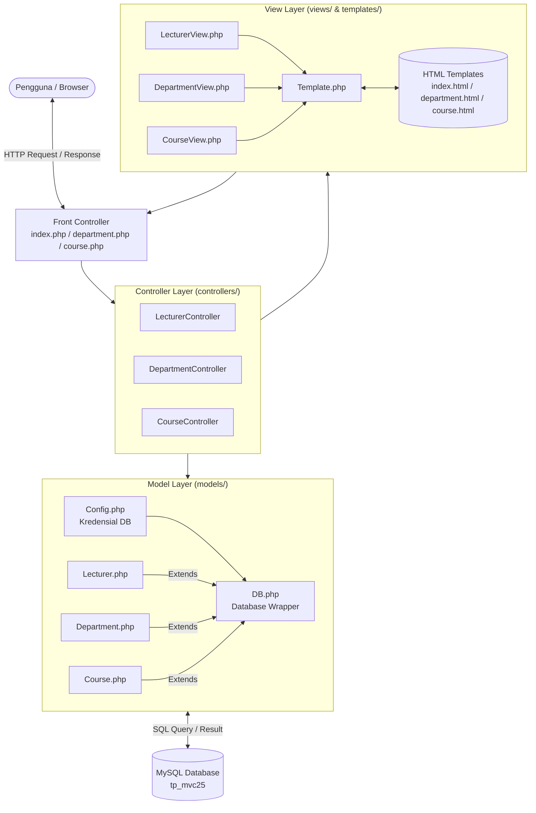

---

## Perancangan Basis Data (Database Design)

### Diagram Relasi Antar Tabel (ERD)

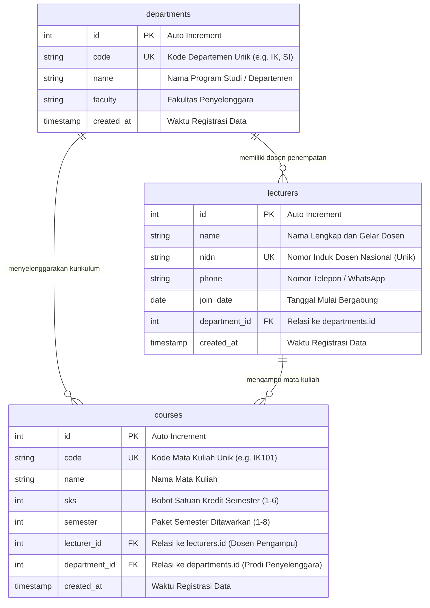

### Struktur Tabel & Integritas Relasi

1. **Tabel `departments` (Departemen / Program Studi):**
   - `id` (INT, PK, AUTO_INCREMENT): Identifikator unik departemen.
   - `code` (VARCHAR(10), UNIQUE, NOT NULL): Kode singkatan prodi (contoh: `IK`, `SI`, `PTE`).
   - `name` (VARCHAR(100), NOT NULL): Nama resmi program studi.
   - `faculty` (VARCHAR(100), NOT NULL): Nama fakultas naungan.
   - `created_at` (TIMESTAMP): Pencatat waktu pembuatan data.

2. **Tabel `lecturers` (Dosen Pengajar):**
   - `id` (INT, PK, AUTO_INCREMENT): Identifikator unik dosen.
   - `name` (VARCHAR(100), NOT NULL): Nama lengkap beserta gelar akademik.
   - `nidn` (VARCHAR(20), UNIQUE, NOT NULL): Nomor Induk Dosen Nasional.
   - `phone` (VARCHAR(20), NOT NULL): Nomor kontak seluler dosen.
   - `join_date` (DATE, NOT NULL): Tanggal mulai mengabdi di kampus.
   - `department_id` (INT, NULL, FK): Kunci tamu ke `departments.id` dengan relasi `ON DELETE SET NULL ON UPDATE CASCADE`.
   - `created_at` (TIMESTAMP): Pencatat waktu pembuatan data.

3. **Tabel `courses` (Mata Kuliah):**
   - `id` (INT, PK, AUTO_INCREMENT): Identifikator unik mata kuliah.
   - `code` (VARCHAR(20), UNIQUE, NOT NULL): Kode mata kuliah kurikulum.
   - `name` (VARCHAR(150), NOT NULL): Nama lengkap mata kuliah.
   - `sks` (INT, NOT NULL): Bobot kredit pembelajaran (1 hingga 6 SKS).
   - `semester` (INT, NOT NULL): Semester penawaran mata kuliah (1 hingga 8).
   - `lecturer_id` (INT, NULL, FK): Dosen pengampu berelasi ke `lecturers.id` dengan `ON DELETE SET NULL ON UPDATE CASCADE`.
   - `department_id` (INT, NOT NULL, FK): Prodi penyelenggara berelasi ke `departments.id` dengan `ON DELETE CASCADE ON UPDATE CASCADE`.
   - `created_at` (TIMESTAMP): Pencatat waktu pembuatan data.

---

## Struktur Direktori Repositori

```text
tp8/
├── Dokumentasi/                       # Direktori bukti pengujian antarmuka & rekaman layar
│   ├── 01_halaman_utama_lecturers.png     # Tangkapan layar beranda dosen
│   ├── 02_tambah_dosen_sukses.png         # Tangkapan layar hasil penambahan dosen
│   ├── 03_edit_data_dosen.png             # Tangkapan layar formulir edit dosen
│   ├── 04_halaman_departments.png         # Tangkapan layar beranda departemen
│   ├── 05_tambah_department_sukses.png    # Tangkapan layar hasil penambahan departemen
│   ├── 06_edit_department.png             # Tangkapan layar formulir edit departemen
│   ├── 07_halaman_courses.png             # Tangkapan layar beranda mata kuliah
│   ├── 08_tambah_course_sukses.png        # Tangkapan layar hasil penambahan mata kuliah
│   ├── 09_edit_course.png                 # Tangkapan layar formulir edit mata kuliah
│   ├── 10_hapus_data_sukses.png           # Tangkapan layar penghapusan data
│   └── demo_mvc.gif                       # Rekaman animasi interaktif demo seluruh sistem
│
├── Project/                           # Direktori utama kode sumber aplikasi MVC
│   ├── assets/                        # Dependensi berkas statis CSS, JS, dan vendor
│   │   ├── css/
│   │   │   └── bootstrap.min.css          # Pustaka CSS Bootstrap lokal
│   │   └── js/
│   │       ├── bootstrap.bundle.min.js    # Pustaka JS Bundle Bootstrap
│   │       ├── bootstrap.min.js           # Pustaka JS Bootstrap
│   │       ├── jquery.min.js              # Pustaka jQuery
│   │       └── popper.min.js              # Pustaka Popper.js
│   │
│   ├── controllers/                   # Lapisan pengendali logika alur (Controllers)
│   │   ├── CourseController.php           # Logika aksi CRUD entitas mata kuliah
│   │   ├── DepartmentController.php       # Logika aksi CRUD entitas departemen
│   │   └── LecturerController.php         # Logika aksi CRUD entitas dosen
│   │
│   ├── models/                        # Lapisan data & query database (Models)
│   │   ├── DB.php                         # Kelas dasar pembungkus operasi MySQLi
│   │   ├── Course.php                     # Model query dan relasi tabel courses
│   │   ├── Department.php                 # Model query tabel departments
│   │   └── Lecturer.php                   # Model query dan relasi tabel lecturers
│   │
│   ├── templates/                     # Berkas antarmuka HTML murni (Templates)
│   │   ├── course.html                    # Template antarmuka CRUD mata kuliah
│   │   ├── department.html                # Template antarmuka CRUD departemen
│   │   └── index.html                     # Template antarmuka CRUD dosen
│   │
│   ├── views/                         # Lapisan penyaji data ke template (Views)
│   │   ├── CourseView.php                 # Penyaji data dan opsi dropdown ke course.html
│   │   ├── DepartmentView.php             # Penyaji data ke department.html
│   │   ├── LecturerView.php               # Penyaji data dan opsi dropdown ke index.html
│   │   └── Template.php                   # Mesin pengganti token placeholder string
│   │
│   ├── config.php                     # Definisi parameter kredensial database
│   ├── course.php                     # Front controller entitas mata kuliah
│   ├── department.php                 # Front controller entitas departemen
│   └── index.php                      # Front controller entitas dosen (entry point utama)
│
├── tp_mvc25.sql                       # Berkas DDL skema basis data & seed data awal
└── README.md                          # Dokumentasi resmi tugas praktikum
```

---

## Diagram Alur Komunikasi MVC (Sequence Flow)

### 1. Alur Menampilkan Data (HTTP GET)

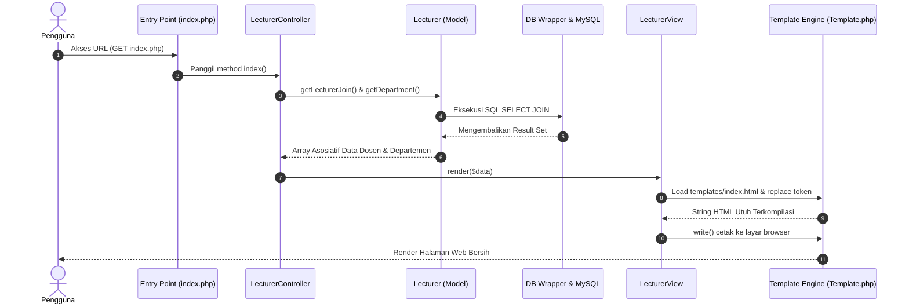

### 2. Alur Tambah / Ubah Data (HTTP POST - PRG Pattern)

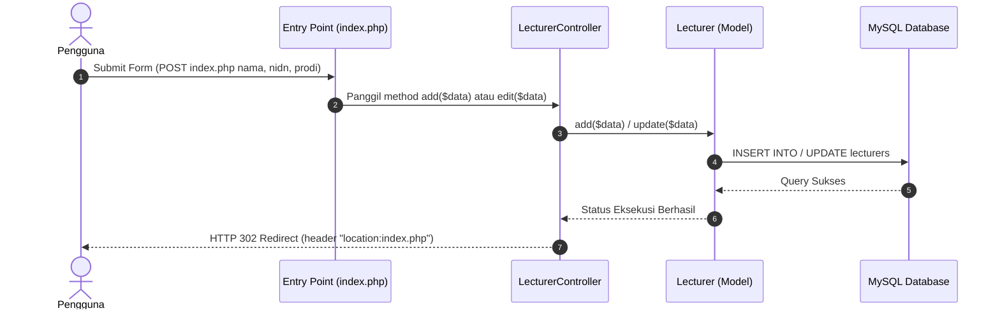

---

## Bedah Modul: Model, View, & Controller

### 1. Lapisan Model (`models/`)
- **`DB.php`:** Mengenkapsulasi koneksi database MySQLi. Membuka koneksi (`open()`), mengeksekusi query aman (`execute()`), mengambil baris data sebagai array asosiatif (`getResult()`), serta menutup koneksi secara bersih (`close()`).
- **`Lecturer.php`:** Menyediakan fungsi agregasi data dosen. Menggunakan query `LEFT JOIN departments` untuk mengambil nama program studi secara otomatis pada daftar tabel dosen.
- **`Department.php`:** Mengelola tabel unit akademik prodi. Dilengkapi fungsi pencegahan duplikasi kode jurusan.
- **`Course.php`:** Mengelola tabel kurikulum perkuliahan. Melakukan query relasi ganda `LEFT JOIN lecturers` dan `LEFT JOIN departments` sehingga informasi dosen pengampu dan prodi tampil komprehensif.

### 2. Lapisan View (`views/` & `templates/`)
- **`Template.php`:** Mesin template berbasis *token replacement*. Membaca file template HTML murni menggunakan `file_get_contents()`, mengganti token khusus (`DATA_TABEL`, `DATA_TITLE_FORM`, `DATA_BUTTON_NAME`, dll.) menggunakan fungsi `preg_replace()` atau `str_replace()`, lalu mencetak output akhir melalui `write()`.
- **`LecturerView.php`, `DepartmentView.php`, `CourseView.php`:** Menyiapkan string HTML untuk tabel data, status lencana (*badge*), tombol aksi modal edit/hapus, serta merender pilihan `<option>` dinamis dari tabel relasi pada formulir input.

### 3. Lapisan Controller (`controllers/`)
- **`LecturerController.php`, `DepartmentController.php`, `CourseController.php`:** Menerima input dari front controller. Mengatur kondisi apakah sistem sedang berada pada mode *List*, mode *Create*, mode *Edit*, atau mode *Delete*. Mengimplementasikan pola *Post/Redirect/Get (PRG)* untuk mencegah pengiriman formulir berulang saat halaman direfresh.

---

## Fitur & Operasi CRUD Seluruh Entitas

Aplikasi menyediakan fungsionalitas CRUD terpadu tanpa cela pada seluruh entitas:

| Entitas | Create (Tambah) | Read (Tampil) | Update (Ubah) | Delete (Hapus) | Fitur Khusus & Relasi |
| :--- | :---: | :---: | :---: | :---: | :--- |
| **Dosen (`lecturers`)** | ✅ | ✅ | ✅ | ✅ | Terhubung ke tabel `departments`. Dropdown prodi terisi otomatis. Tanggal bergabung diformat ramah pengguna. |
| **Departemen (`departments`)** | ✅ | ✅ | ✅ | ✅ | Master data unit prodi. Dilengkapi kode unik jurusan dan asal fakultas. |
| **Mata Kuliah (`courses`)** | ✅ | ✅ | ✅ | ✅ | Menghubungkan dosen pengampu dan prodi. Menampilkan beban SKS dan semester dalam lencana modern. |

---

## Skenario Pengujian Fungsionalitas (Test Cases)

| ID Pengujian | Kasus Uji | Langkah Pengujian | Hasil yang Diharapkan | Status |
| :---: | :--- | :--- | :--- | :---: |
| **TC-01** | Menampilkan Halaman Dosen | Buka URL `/index.php` | Daftar dosen tampil lengkap dengan kolom No, Nama, NIDN, Kontak, Tgl Gabung, dan Departemen | **PASSED** |
| **TC-02** | Tambah Dosen Baru | Isi form nama, NIDN, HP, tgl gabung, pilih prodi, klik tombol "Tambah Dosen" | Data baru tersimpan di database dan langsung muncul pada baris tabel | **PASSED** |
| **TC-03** | Mode Edit Dosen | Klik tombol aksi "Edit" pada salah satu baris dosen | Form sebelah kiri terisi data dosen terkait, tombol berubah menjadi "Simpan Perubahan" | **PASSED** |
| **TC-04** | Simpan Pemutakhiran Dosen | Ubah nama atau nomor kontak, klik "Simpan Perubahan" | Data dosen berhasil diperbarui dan form kembali ke mode penambahan awal | **PASSED** |
| **TC-05** | Hapus Dosen | Klik tombol aksi "Hapus" dan konfirmasi pada dialog pop-up | Data dosen terhapus dari tabel dan database secara bersih | **PASSED** |
| **TC-06** | Menampilkan Halaman Departemen | Buka menu navigasi `/department.php` | Tabel daftar program studi dan fakultas tampil dengan rapi | **PASSED** |
| **TC-07** | Tambah Departemen Baru | Input kode prodi, nama prodi, nama fakultas, klik "Tambah Departemen" | Prodi baru tersimpan dan otomatis menjadi opsi pilihan di form dosen & matkul | **PASSED** |
| **TC-08** | Edit Departemen | Klik "Edit" pada salah satu departemen, ubah fakultas, klik simpan | Perubahan fakultas berhasil tersimpan di basis data | **PASSED** |
| **TC-09** | Menampilkan Halaman Mata Kuliah | Buka menu navigasi `/course.php` | Tabel mata kuliah tampil dengan rincian SKS, semester, nama dosen, dan prodi | **PASSED** |
| **TC-10** | Tambah Mata Kuliah Baru | Input kode matkul, nama, SKS, semester, pilih dosen pengampu & prodi | Mata kuliah baru tersimpan dan berelasi tepat ke dosen serta departemen | **PASSED** |
| **TC-11** | Edit Mata Kuliah | Klik "Edit" pada mata kuliah, ubah semester atau dosen pengampu | Perubahan dosen pengampu berhasil diperbarui | **PASSED** |
| **TC-12** | Integritas Foreign Key Hapus | Menghapus dosen yang sedang mengampu mata kuliah | Dosen terhapus, kolom dosen pada mata kuliah otomatis bernilai NULL (*Set Null*) tanpa merusak data matkul | **PASSED** |

---

## Dokumentasi Antarmuka & Demonstrasi Eksekusi

### Rekaman Interaktif Sistem (Demo Animasi GIF)


---

### Galeri Tangkapan Layar Antarmuka Program

#### 1. Halaman Utama — Manajemen Dosen (Lecturers)

*Tampilan utama beranda dengan navigasi responsif, formulir penambahan dosen di sebelah kiri, dan tabel daftar dosen terdaftar di sebelah kanan berarsitektur MVC.*

#### 2. Tambah Data Dosen Sukses
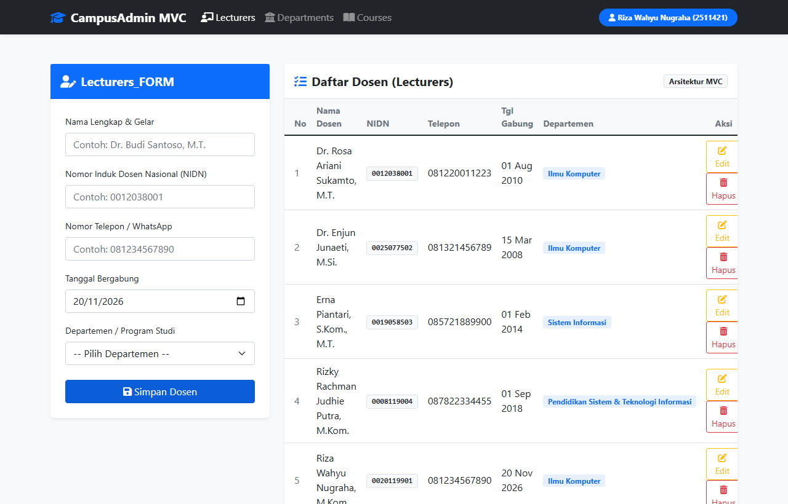
*Hasil penambahan data dosen baru yang langsung terintegrasi dengan dropdown data departemen.*

#### 3. Formulir Edit Data Dosen
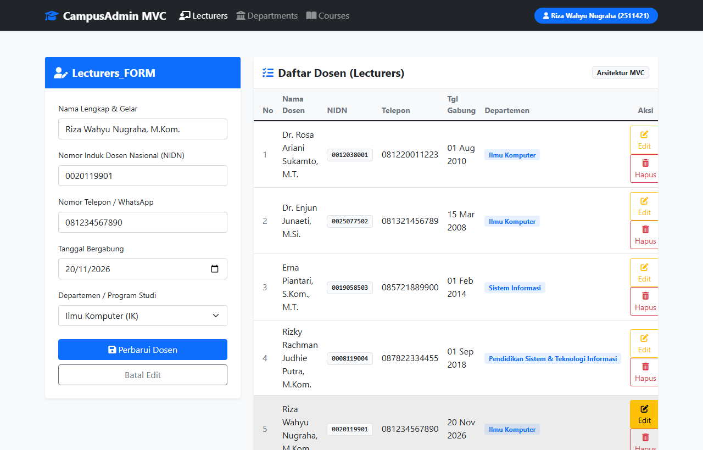
*Mode pengubahan data dosen di mana formulir otomatis terisi (*pre-filled*) dengan data yang dipilih beserta tombol pembatalan.*

#### 4. Halaman Manajemen Departemen / Program Studi
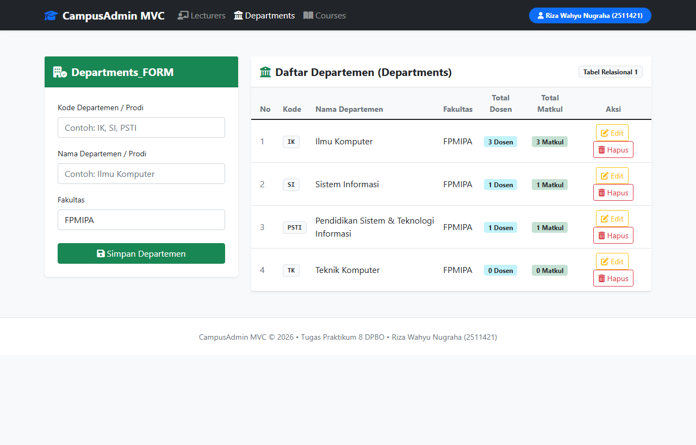
*Antarmuka pengelolaan entitas baru `departments` menampilkan kode prodi, nama prodi, dan fakultas.*

#### 5. Tambah Data Departemen Sukses
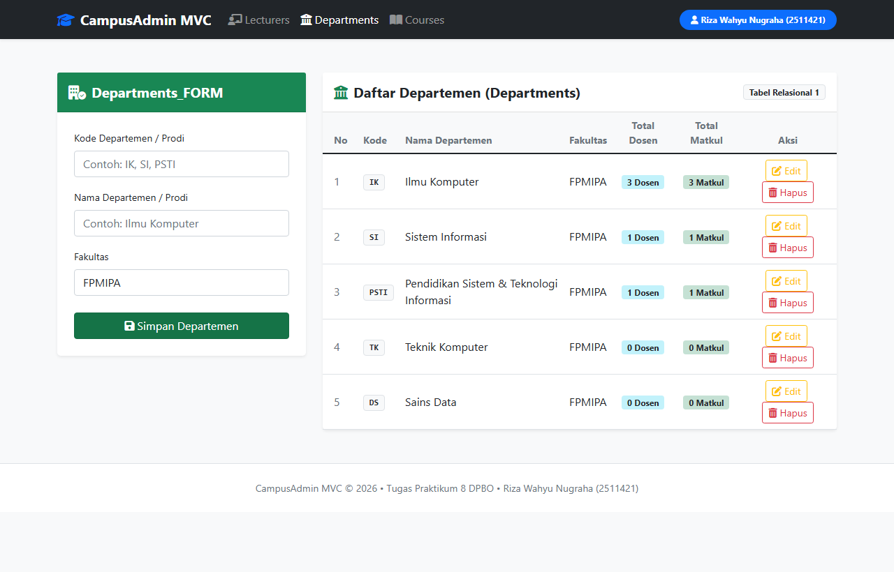
*Data prodi baru berhasil ditambahkan dan siap digunakan sebagai referensi foreign key entitas dosen dan mata kuliah.*

#### 6. Formulir Edit Data Departemen
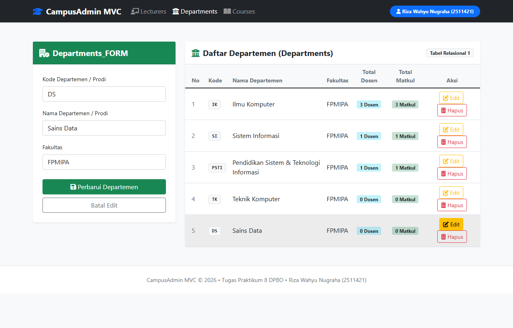
*Mode penyuntingan entitas departemen untuk memperbarui nama jurusan atau fakultas.*

#### 7. Halaman Manajemen Mata Kuliah (Courses)
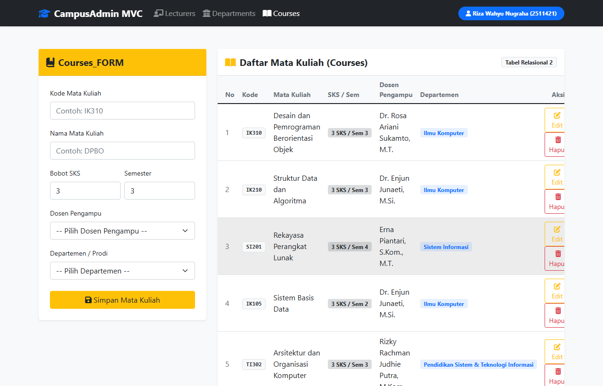
*Antarmuka pengelolaan entitas baru `courses` yang menampilkan kode matkul, nama, bobot SKS, semester, dosen pengampu, dan prodi.*

#### 8. Tambah Data Mata Kuliah Sukses
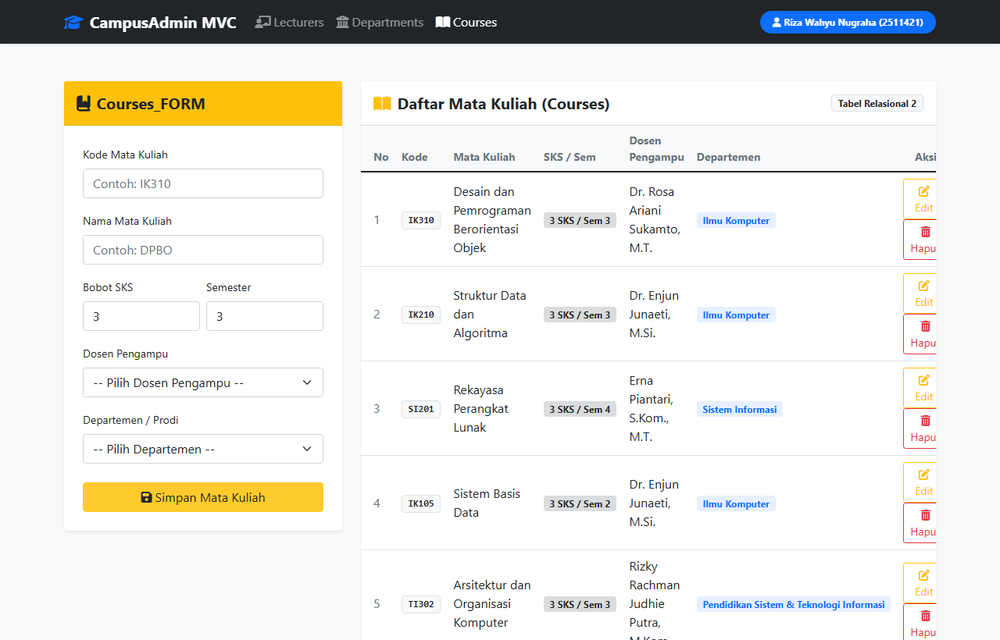
*Penambahan mata kuliah baru dengan relasi ganda ke tabel dosen pengajar dan departemen terkait.*

#### 9. Formulir Edit Data Mata Kuliah
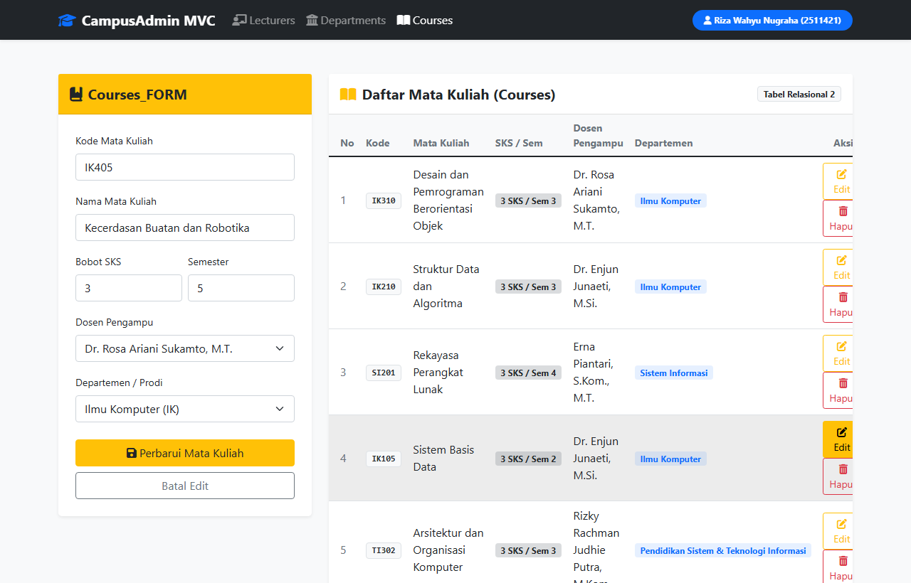
*Mode pemutakhiran kurikulum mata kuliah, penyesuaian bobot kredit SKS, dan pergantian dosen pengampu.*

#### 10. Konfirmasi & Penghapusan Data Sukses
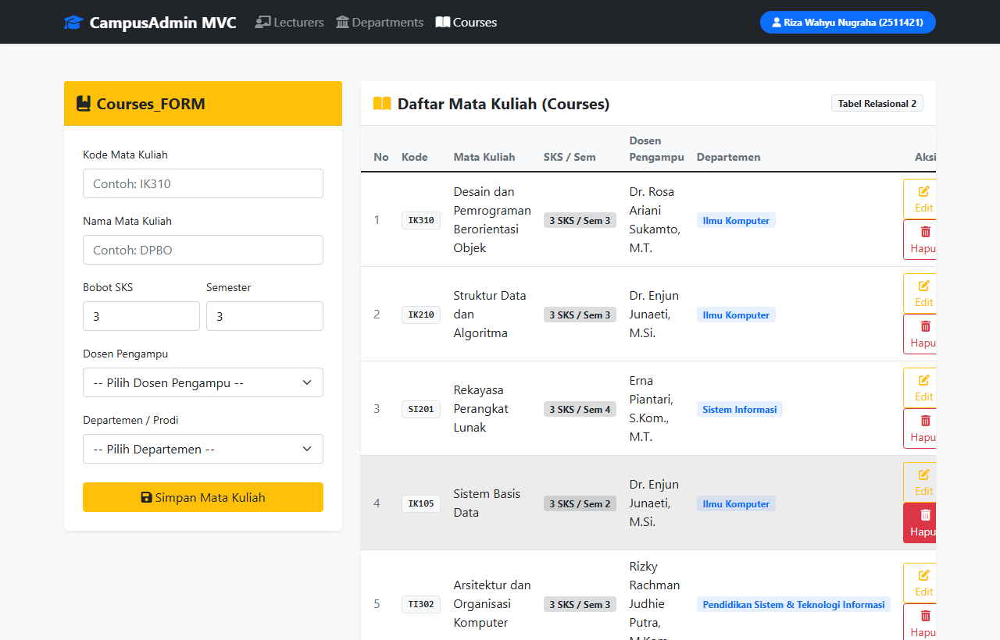
*Operasi penghapusan data dengan proteksi dialog konfirmasi JavaScript untuk menjamin keamanan integritas data.*

---

## Panduan Setup & Menjalankan Program

### 1. Prasyarat Sistem
- **Web Server:** XAMPP, Laragon, atau PHP Built-in Server CLI (PHP versi 8.0 ke atas).
- **Database Server:** MySQL 8.0 / MariaDB 10.4 atau lebih baru.
- **Web Browser:** Google Chrome, Mozilla Firefox, Microsoft Edge, atau Safari modern.

### 2. Langkah Instalasi Basis Data
1. Buka aplikasi manajemen MySQL (seperti **phpMyAdmin** atau HeidiSQL) atau gunakan terminal.
2. Buat database baru bernama `tp_mvc25`:
   ```sql
   CREATE DATABASE tp_mvc25;
   ```
3. Import berkas `tp_mvc25.sql` yang ada di direktori root proyek:
   - Melalui phpMyAdmin: Pilih tab **Import**, unggah berkas `tp_mvc25.sql`, lalu klik **Go**.
   - Melalui Terminal / Command Prompt:
     ```bash
     mysql -u root -p tp_mvc25 < tp_mvc25.sql
     ```

### 3. Konfigurasi Koneksi Database
Buka berkas `Project/config.php` dan pastikan konfigurasi kredensial MySQL sesuai dengan lingkungan lokal Anda:
```php
class Config
{
    public static $db_host = "localhost";
    public static $db_user = "root";
    public static $db_pass = "";
    public static $db_name = "tp_mvc25";
}
```

### 4. Menjalankan Server Aplikasi

#### Opsi A: Menggunakan Laragon / XAMPP (Direkomendasikan)
1. Pindahkan folder `tp8` ke dalam direktori `htdocs` (pada XAMPP) atau direktori `www` (pada Laragon).
2. Pastikan service **Apache** dan **MySQL** telah dijalankan (*Running*).
3. Buka peramban web dan akses URL:
   ```text
   http://localhost/tp8/Project/index.php
   ```

#### Opsi B: Menggunakan PHP Built-in Server CLI
1. Buka terminal atau Command Prompt pada direktori `tp8/Project`:
   ```bash
   cd "tp8/Project"
   ```
2. Jalankan perintah server lokal PHP:
   ```bash
   php -S localhost:8000
   ```
3. Buka peramban web dan akses tautan:
   ```text
   http://localhost:8000/index.php
   ```

---

## Troubleshooting & FAQ

1. **Pesan Kesalahan: `Access denied for user 'root'@'localhost'`**
   - *Penyebab:* Kata sandi (*password*) pengguna basis data MySQL berbeda dengan setelan bawaan.
   - *Solusi:* Buka `Project/config.php` dan sesuaikan nilai properti `public static $db_pass` dengan kata sandi MySQL komputer Anda.

2. **Tabel Dosen Kosong atau Dropdown Departemen Tidak Muncul**
   - *Penyebab:* Skrip basis data awal `tp_mvc25.sql` belum diimpor atau nama database salah.
   - *Solusi:* Pastikan database `tp_mvc25` telah dibuat dan tabel `departments`, `lecturers`, serta `courses` telah memiliki data awal (*seed data*).

3. **Gagal Menghapus Data Departemen**
   - *Penyebab:* Fitur *Foreign Key Constraint* mengamankan data anak yang berelasi.
   - *Solusi:* Tabel `courses` menggunakan aturan `ON DELETE CASCADE` sehingga mata kuliah yang berada di bawah departemen tersebut akan otomatis terhapus bersama departemennya.

---

<p align="center">
  <b>CampusAdmin MVC &bull; Tugas Praktikum 8 DPBO 2026</b><br>
  Riza Wahyu Nugraha (2511421) &bull; Kelas C1 &bull; Universitas Pendidikan Indonesia
</p>
